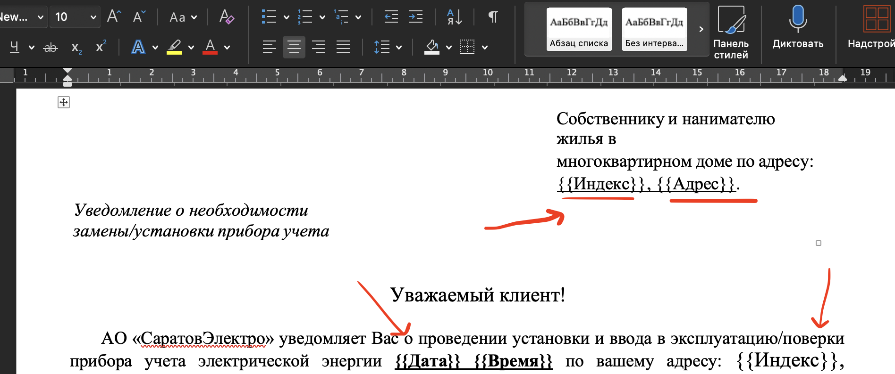
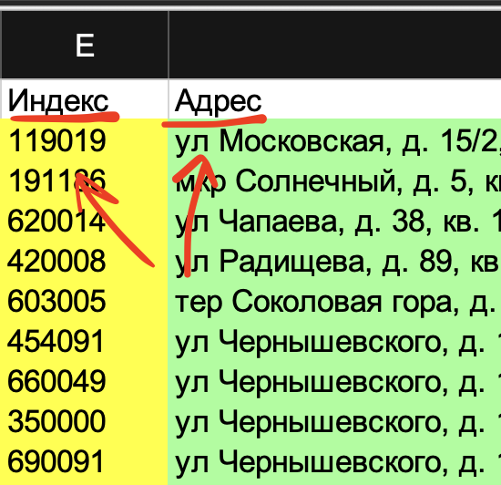

# SimpleDocGenerator
(sorry for spagetti)

# Использование


В шаблонах должны быть указаны названия полей СООТВЕТСТВУЮЩИЕ названиям полей из Excel файла
В формате: `{{Название}}` без пробелов






# Спецификаторы

Спецификатор пишется после поля через двоеточие: `{{Поле:addr}}`.

| Тег | Где | Результат |
|---|---|---|
| `{{Поле}}` | Word, Excel | значение столбца |
| `{{Поле:addr}}` | Word, Excel | адрес по `address_config.json` |
| `{{Поле:time}}` | Word, Excel | `в 10:00`, `с 10:00 до 12:00` |
| `{{Поле:raw}}` | Word | значение столбца без изменений |
| `{{:num}}` | Excel | номер записи |
| `{{...:table}}` | Word | таблица по группам записей |
| `{{Поле:sign}}` | Word | подпись человека из поля |

## Подписи

Подписи лежат в папке шаблонов, в папке `Подписи`. Для каждого человека создайте папку с его именем из данных. Положите в неё картинки PNG или JPG с любыми именами.

Программа сравнивает в именах только буквы и цифры, без учёта регистра. Буква «ё» равна «е». Латинские буквы, похожие на русские, равны русским. Пример: «Александров А.Т.» найдёт папку «Александров А Т».

Место подписи в шаблоне Word:
1. Вставьте картинку `Подписи/заглушка_подписи.png`. Задайте размер, место и обтекание.
2. В замещающем тексте картинки напишите `{{фио:sign}}`.

Программа вставит в рамку случайную подпись этого человека без искажения. Тег `{{фио:sign}}` в тексте вставит подпись в строку высотой 12 мм.

Если папки или картинок нет, программа покажет ошибку с номером записи. Фон подписи программа не удаляет: для подписи поверх линии нужен PNG с прозрачным фоном. В колонтитуле будет одна подпись на весь файл. В шаблонах с `:table` и в Excel подписей нет.

# Запуск

(требуется Python 3.12.13)
```bash
pip install -r requirements.txt
python main.py
```

# Компиляция

```bash
pip install -r requirements.txt
```
(требуется Python 3.12.13)

```bash
pyinstaller --noconfirm --onefile --windowed --icon "exe_belly/app_icon.ico" --add-data "exe_belly;exe_belly" --collect-all docxcompose --collect-all customtkinter --collect-all tkinterdnd2 --name "DocGenerator" main.py
```
или
```bash
pyinstaller DocGenerator.spec
```
